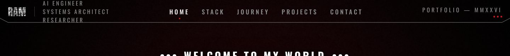
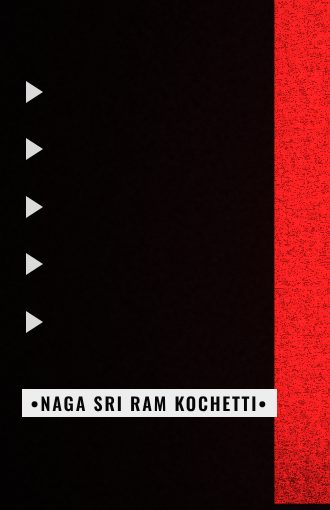
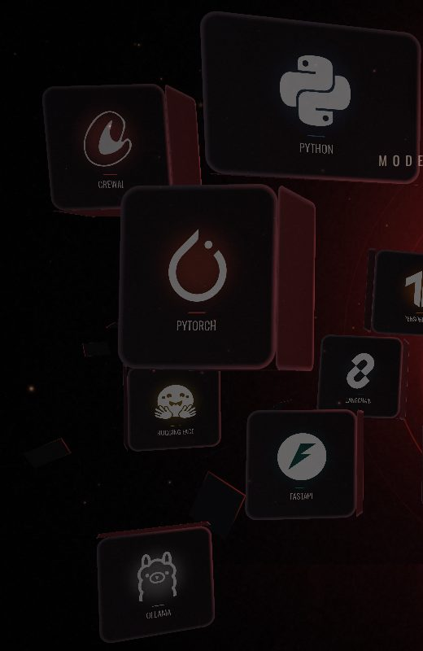
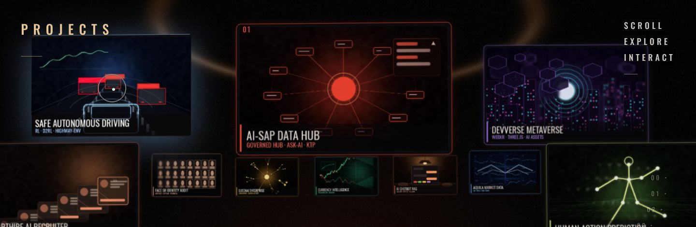
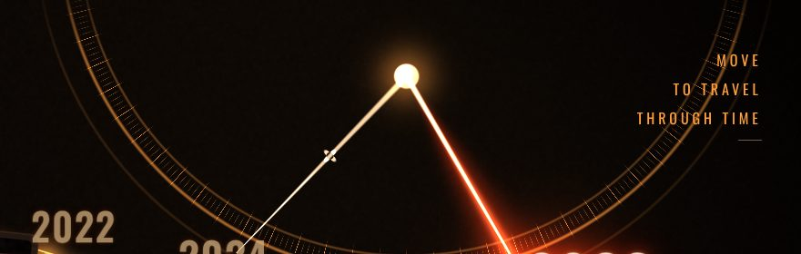

# Reference analysis

**Reference:** https://project-vercel-hosting-faa90e.vercel.app/ (a personal portfolio titled "RAM")
**Scope:** study its creative and interaction design and extract transferable principles for the drift / R3F portfolio. This is not a visual clone brief.
**Companion docs:** [animation-specification](animation-specification.md) · [interaction-map](interaction-map.md) · [scene-architecture](scene-architecture.md) · [implementation-roadmap](implementation-roadmap.md)

## How to read the labels

| Label | Meaning |
|---|---|
| **[SRC]** | Confirmed by reading the reference's own, unminified source (35 ES modules, 7 CSS files, `index.html`, `manifest.json`), downloaded from the live host. |
| **[OBS]** | Confirmed by rendering the live site in headless Chromium (Playwright, software WebGL) at 1440x900 and on an iPhone 13 profile, and looking at screenshots. |
| **[ASSUMPTION]** | An inference. Not directly verified. Treat as a hypothesis. |

Limits of this study: no real GPU (software WebGL), so I did not measure frame rate; no interaction recordings, only still frames at fixed scroll positions; I did not read every shader body line by line (about 1,400 lines across `gl/shaders*.js`). Anything about timing comes from the source constants, not from measuring a running page.

## 0. Correction to an earlier finding

An earlier pass of this analysis used the GitHub repository `nagasriramnani/3d-Portfolio-Website` as if it were the deployed site. **It is not.**

| | GitHub repo (older or alternate build) | Deployed site (the actual reference) |
|---|---|---|
| Framework | Next.js 14, React 18, framer-motion, Tailwind | **None.** Vanilla ES modules built with Vite and served unbundled. [SRC] |
| Hero | 120-frame PNG sequence scrubbed on a 2D canvas inside a `500vh` sticky | **WebGL2 compositor** drawing a video-cut-out walker in front of 3D-less quad letters. [SRC] |
| Scenes | One scroll sequence plus ordinary React sections | **Six cinematic scenes**, most with their own WebGL2 context. [SRC] |

Everything below describes the deployed site. The earlier contact-sheet images in `docs/assets/ref-sequence-*.jpg` and `ref-frame-*.jpg` come from the repo, not the live site.

## 1. What the site is

[SRC] A single-page, scroll-driven "film": a black boot screen, then a hero ("RAM" in huge red letters with a person walking through them), then five pinned scenes that you scroll through. Each scene is a tall section with a `position: sticky` child (`.universe__pin`, `.chrono__pin`, `.gallery__pin`, `.fin__pin`; `walk` uses `.walk__pin`). Nothing navigates to another page. "Page transitions" are scroll glides between sections.

Section order and measured height (desktop 1440x900, total document 12,150 px = 13.5 screens) [OBS]:

| Id | Chapter | Starts at | Height | Idea |
|---|---|---|---|---|
| (hero) | 00 | 0 | 900 | Boot, then title scene. Fixed behind the flow. |
| `walk` | 01 | 900 | 2,880 | Camera pull-back on one photo plus a drawn route (Vizag, Liverpool, London, Belfast). |
| `stack` | 02 | 3,780 | 1,710 | "The Engineering Universe": 18 tool cards floating in 3D around a figure. |
| `chrono` | 03 | 5,490 | 2,160 | "A Journey Through Time": six year cards on a rail, a clock hand follows the cursor. |
| `gallery` | 04 | 7,650 | 2,340 | "Projects": 12 project cards in depth around a figure. |
| `fin` | 05 | 9,990 | 2,160 | Finale: scroll pushes in on the subject, contact card fades in. |

On the iPhone profile the same sections are shorter (document 8,034 px at 664 px viewport height). [OBS]

## 2. The twelve areas

### 2.1 Opening and entrance animation

- **Black boot first.** `#boot` is a black screen with a thin progress bar. It enforces `MIN_BLACK = 620` ms of true black, then waits for fonts, two textures (grunge, grain) and the hero clip to be decodable. [SRC]
- **Patience budget.** If the clip is not decodable after `CLIP_PATIENCE = 4500` ms, it shows a packed still frame and swaps to video at the next loop seam. If autoplay is refused, an "Enter" gesture button appears. If there is no WebGL or no manifest, a `degrade()` path shows a plain fallback. [SRC]
- **One clock.** The whole opening is a single timeline `T` in seconds: figure fades in at 0.30 s (2.05 s long), letters begin at 2.10 s with a 0.145 s stagger (each 1.65 s), ember glow 2.45 s, welcome strip 2.90 s, name chip 3.18 s, location chip 3.32 s, arrows 3.46 s, dot grids 3.62 s, header 4.45 s, settled 6.25 s. [SRC] Beats overlap on purpose, so there is never a "wait for the previous thing to finish" feel.
- **Reveal order.** Letters reveal centre-outward, not left-to-right. [SRC]
- **Review hooks.** `?t=<sec>` and `?t=end` seek the timeline, plus `window.__shot`, `__tune`, `__hero`. [SRC]

### 2.2 Character intro and movement

- The figure is a pre-rendered video, not a 3D model. The video is 720x1280, 24 fps, 240 frames, **packed alpha**: the left half is premultiplied colour and the right half is the matte, decoded in the shader. That gives per-pixel transparency in every browser including Safari, which lacks reliable alpha video. [SRC]
- A baked per-frame **subject track** (x, y, w, h of the body for each of 240 frames) is stored in `manifest.json`, so the shader can place the shadow and sizing without analysing pixels. [SRC]
- The walker **dissolves into darkness at the loop seam**, so the loop point is hidden. [SRC]
- A **shadow of the figure is cast onto the letters** (drawn between letters and figure in the pass order). This is the main depth cue of the hero. [SRC]
- Idle: letters bob on summed sines; pointer parallax is gated in after settling (damp rate 3.1). [SRC]

### 2.3 Interactive 3D scenes

None of the scenes is a loaded 3D model. They are **procedural WebGL2 stages** written with raw GL and custom shaders (`gl/renderer.js`, `shaders*.js`, `lib/mat4.js`): rooms, rings, rails, a clock dial, rotating mechanisms, energy ribbons, embers, floor lines. Cards that look 3D (thick slab with a red edge) are quads drawn by the shader. [SRC][OBS]

### 2.4 Floating elements around the character

- 18 tool cards in the stack scene (the gallery scene has 12 project cards) are placed from a measured reference layout, with depth inferred from apparent size and solved for perspective. Cards are different sizes by depth, not by a layout grid. [SRC]
- A glowing red **light-painting ribbon** traces a parametric curve around the head over 7.5 s (340 segments, drawn in depth bands so it can pass in front of and behind cards). [SRC][OBS]
- 900 **embers** are animated entirely in the vertex shader (no per-frame CPU). [SRC]
- Debris slabs drift in the back plane. [SRC][OBS]

### 2.5 Project cards and presentation

- The gallery has **12 DOM `<button>` cards** (`.g-card`) positioned from a single `fitCover()` mapping, over a WebGL environment built from a re-lit photo plate. Cards are crisp, selectable and keyboard-focusable; the glow, ring and floor are canvas. [SRC][OBS]
- A caption line at the bottom shows the full project name on hover. [OBS]
- Hover lifts the card and **eases the siblings back** (`.gallery__deck.is-hot .g-card:not(:hover)`). [SRC]
- Cards are art-directed sprites (one image per project, 250 to 500 KB each), not live screenshots. [SRC][OBS]

### 2.6 Cursor-reactive effects

Four separate cursor behaviours, all using one pointer state:

1. **Custom cursor** (`#cur`): a dot that follows instantly and a ring damped at rate 14; `is-link` on interactive elements and `is-down` on press. Disabled for touch and reduced motion. [SRC]
2. **Scene parallax:** the universe, chrono, gallery and finale damp pointer yaw / offset by depth, so near cards move more than far cards. [SRC]
3. **Hover captions:** the stack shows a tool note in a live caption; the pointer is mapped to the card shell. [SRC]
4. **Cursor as input to a mechanism:** in the chrono scene the cursor is projected onto the polyline through the card centres, and that position drives the clock hand and which year is "lit". [SRC][OBS]

### 2.7 Scroll-triggered animation

- **Scrub scenes:** the walk scene maps scroll progress to a camera zoom (face close-up, zoom 2.6x, to the full frame), to story lines, and to a route-draw (`stroke-dashoffset`) across scroll window 0.58 to 0.94. Progress is damped (rate 14) from the sticky section's `getBoundingClientRect`. [SRC]
- **Push-in:** the finale pushes toward the subject (smoothstep over progress 0.06 to 0.86); classes `is-pushed` (above 0.35) and `is-close` (above 0.72) switch the DOM, and the closing card fades in between 0.62 and 0.96. [SRC]
- **Triggered one-shots:** the stack, chrono, gallery and finale scenes each have an **intro timeline that starts when the scene first enters the viewport**, running at 2.0 to 2.6x speed so it reads quickly while the user keeps scrolling (`INTRO_SPEED`). [SRC]
- **Kinetic titles** split into lines that rise on intersection (threshold 0.4, 0.12 s stagger). [SRC]

### 2.8 Page-to-page transitions

There are none. [SRC] The site is one page. Navigation is `window.__glideTo(target)` at 1.4 s with a cubic ease-out, over a custom inertial scroll. A `.wipe` element exists for chapter wipes. [SRC]

### 2.9 Scene transitions and loading

- Scenes do not cross-fade. They are **hard-pinned, one after another**, and each scene's intro plays on arrival, so the "transition" is the scene building itself. [SRC][OBS]
- Each scene's WebGL loop **runs only while on screen** (`IntersectionObserver` with a 100 % root margin) and when the tab is visible. [SRC]
- Fallback ladder: still image, then video, and `is-fallback` classes when WebGL is missing. [SRC]

### 2.10 Micro-interactions, buttons and navigation

- Header: logo, role list, five-item nav, "Portfolio - MMXXVI" meta, a chamfered SVG rule drawn as a polyline. Nav links get an underline dot that scales in on hover. [SRC][OBS]
- Right-edge **chapter rail** 00 to 05: tiny index numbers with a red active dot. It updates from scroll (last section whose top is above mid-viewport). Hover on the rail reveals the full labels. [SRC][OBS]
- Enter button letter-spacing animates from 0.3 em to 0.4 em on hover. Closing CTA translates 4 px and its arrow extends. [SRC]
- Typographic furniture: bullet-framed chips (`•Naga Sri Ram Kochetti•`), triple-dot dividers, triangle arrow columns, dot grids. They are **DOM**, toggled by classes on `<html>` from the timeline. [SRC][OBS]

### 2.11 Lighting, depth, layering and VFX

- Palette: one hot red `#de1b1c` as ink, paper white `#ededed`, black, grey steps. Each later scene shifts hue (red, then amber / copper) while keeping the same black ground. [SRC][OBS]
- Typography: Anton for display, Oswald for UI, Bodoni Moda italic for the elegant scene titles. [SRC]
- **Ink wear:** letters use a grunge texture (`wear 0.44, wearGain 2.1, wearScale 5.6`) so they look screen-printed, not flat. [SRC][OBS]
- Post: film grain, vignette, a slow pulse. [SRC]
- Layering: canvas background, DOM cards, then a **second transparent canvas** or a matted `` for the figure so the person can stand *in front of* DOM cards. [SRC]

### 2.12 Mobile and responsive behaviour

- Breakpoint: `max-width: 760px`, plus `pointer: coarse` and `prefers-reduced-motion` guards. [SRC]
- Portrait variants exist for the hero and the walk route (`is-portrait` on `<html>`). [SRC][OBS]
- Custom cursor and custom inertial scroll are **disabled** on coarse pointers and for reduced motion. [SRC]
- Pixel ratio is capped at 2 in the scene boots. [SRC]
- Mobile weight is not lower: the iPhone profile still loaded about 100 requests, including the 1.5 MB `hero.webm`, 1.1 MB `lab_plate.jpg` and 0.66 MB `walk/frame.jpg`. [OBS]
- **Defects observed in emulation:** at 390 px the hero showed horizontal overflow (a black strip at the right edge, "WELCOME TO MY WORLD" and the name chip clipped at the left edge), and in the gallery the "SCROLL EXPLORE INTERACT" label overprints a card. I could not get the burger menu to open in headless emulation. [OBS] Treat these as likely real but unproven: they may be partly emulation artefacts.

## 3. Libraries and techniques (likely stack)

| Concern | What it uses | Status |
|---|---|---|
| Build | Vite, native ES modules, no framework | [SRC] |
| 3D / rendering | **Raw WebGL2**, hand-written GLSL, own `mat4`, no three.js | [SRC] |
| Text in WebGL | Own text-to-atlas (`buildWord`), no drei Text / troika | [SRC] |
| Animation | Own timeline sampler (spans plus easings from `lib/ease.js`), no GSAP / Framer | [SRC] |
| Scroll | Own Lenis-style engine (`scrollengine.js`) | [SRC] |
| Cursor | Own rAF loop, transforms only, no React state | [SRC] |
| Video | `<video>` decoded as packed-alpha in shader; own `StillClip` fallback | [SRC] |
| Fonts | Anton, Oswald (self-hosted woff2), Bodoni Moda (Google Fonts) | [SRC] |
| Asset authoring (cut-outs, plates, matting) | Done offline (AI cut-out / re-light) | [ASSUMPTION] |

## 4. What makes it feel premium (the transferable principles)

1. **One clock per scene** with overlapping beats, sampled each frame. No nested timelines to desynchronise.
2. **DOM for text and anything clickable; canvas for atmosphere.** Accessibility and sharp type for free.
3. **Sticky pinned scenes with damped progress**: tall section, sticky child, progress from `getBoundingClientRect`, damped so input never feels stepped.
4. **Intro on arrival, fast.** Scenes build themselves when first seen, at 2 to 2.6x speed.
5. **Render only what is on screen.** Per-scene IntersectionObserver gating.
6. **Depth from layering, not geometry.** A figure that stands in front of cards (second canvas) is worth more than extra polygons.
7. **A single accent colour** with a restrained palette shift per scene.
8. **The cursor is an instrument**, not decoration: it drives a mechanism (the clock hand), parallax by depth and captions.
9. **Holding true black** before the reveal, then revealing in a choreographed order.
10. **Graceful ladders:** WebGL, then still, then plain markup; reduced-motion jumps to the settled state.

## 5. Comparison with the existing portfolio (summary)

Detail and sequencing are in [implementation-roadmap](implementation-roadmap.md). In short:

| Area | Keep | Replace or redesign | Introduce |
|---|---|---|---|
| Opening | The 9.6 s time-based timeline and shared `clock`, the rev-counter loader, `?t=end` hook | Loader should hold true black and gate on real asset readiness | Overlapping DOM cues driven from the same clock |
| Hero scene | Procedural drift car, smoke, skid marks, 3D wordmark, quality tiers | Nothing structural | Cast shadow of the car onto the wordmark; worn-ink material on the wordmark |
| Scroll | Lenis (already installed) | Remove unused deps (gsap, react-router) or put them to use | Pinned sticky scenes with damped progress; nav glide |
| Sections | `useReveal`, section-tracking nav, content files | Sections are plain stacked blocks | Scene per section (Garage, Track, Pit Crew, Finish) with intro-on-arrival |
| Cursor | None | n/a | Instrument cursor with `is-link`, `is-down`; cursor-driven mechanism (tachometer or timeline) |
| Mobile | Reduced-motion support | Define a coarse-pointer path | Portrait variants; weight budget |
